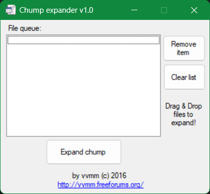

# Chump Editor

[](https://github.com/SilverGreen93/ChumpEditor/releases/latest) [](https://github.com/SilverGreen93/ChumpEditor/releases/latest) 

Editor for config.chump or config.txt files.

Features:
- Can convert Trainz `.chump` files - the binary form of an asset's `config.txt` - to and from their readable text form.
- Can be used directly as an editor for config.txt/config.chump files
- Contains tweaks to modernize obsolete config files (see below)
- Offers syntax highlighting



For CLI, the extension picks the direction: a `.chump` (or `.cdp`) is expanded into
`.txt`, a `.txt` is packed back into `.chump`. The text that comes out is laid
out the way Trainz writes it - UTF-8 with a BOM, CRLF line endings, values
starting on column 40 - so a file you never touched comes back byte for byte.

## Getting Started

From a terminal:

```
pip install -e ".[gui]"
chumpeditor-gui                 # open the GUI
chumpeditor config.chump        # -> config.txt beside it
chumpeditor config.txt          # -> config.chump beside it
```

Or, from a checkout, without installing anything (only needs Python 3.9+ and
PyQt6 for the GUI):

```
python chumpeditor_cli_entry.py config.chump
python chumpeditor_gui_entry.py
```

Prebuilt Windows builds come as a portable zip and a per-user MSI; see
[Releases](https://github.com/SilverGreen93/ChumpEditor/releases/latest).

## Command line

```
usage: chumpeditor [-h] [-o OUT] [--stdout] [paths ...]

Convert Trainz .chump files to and from their text form.

positional arguments:
  paths          .chump files to expand and/or .txt files to pack back

options:
  -h, --help     show this help message and exit
  -o, --out OUT  write the result here instead of beside the input, same name,
                 other extension
  --stdout       print the text form instead of writing a file
```

- The output normally lands next to the input, same name, other extension. Any
  file already there is overwritten, since that is the file this tool wrote.
- `-o` names the output instead (one input file only).
- `--stdout` prints the text form and writes nothing.
- Run it with **no arguments** and the GUI opens instead.
- Several files at once are fine - `chumpeditor config1.chump config2.chump`,
  or let your shell expand a wildcard (PowerShell does not do that by itself,
  so there `Get-ChildItem *.chump | ForEach-Object { chumpeditor $_ }`). One
  bad file is reported and the rest still convert; the exit code is `1` if
  anything failed.

```
chumpeditor config.chump                    # expand
chumpeditor config.chump --stdout           # just look at it
chumpeditor config.txt -o rebuilt.chump     # pack to a chosen name
```

The verbs in the output name the direction: `expanded` writes text, `packed`
writes binary.

## GUI

The main area is one rich text editor: the text form of a file in a fixed width
font, coloured by keyword. The colours are paint rather than content - undo only
ever goes back over the text, and what is saved is plain text whatever a line
looked like.

- Name a `.chump`, `.cdp` or `.txt` on the command line, or drop one anywhere on
  the window (including onto the text), and it opens straight in the editor; a
  binary chump is expanded for display and nothing is written until you save.
- The title carries the file's name and a `*` while it has changes that are
  not on disk.
- Work that is not on disk is asked about before anything replaces it - opening
  a file, dropping one in, or quitting - with **Save**, **Discard** and
  **Cancel**. Nothing is written unless you choose Save, and a Save that is
  then talked out of stops the whole thing.
- One file at a time. Several paths at once open the first and say which ones
  were left out.
- **File**: Open file... (Ctrl+O, filtered to `.chump`, `.cdp` and `.txt`), Save
  chump (Ctrl+S), Save chump as..., Export txt (Ctrl+E), Export txt as..., Exit.
- **Edit**: Undo, Redo, Copy, Cut, Paste, Select All.
- **Tweaks**: Convert obsolete lists, Convert asset-filename to mesh-table and
  Remove language tags - the tidy-ups of the way older versions of Trainz wrote
  a file.
- **Help**: About - what the program does, the version, the copyright and a link
  to this repository.

### Tweaks

#### Convert obsolete lists

Older assets write a list as a run of numbered tags:

```
category-era-0                        "1920s"
category-era-1                        "1930s"
category-era-2                        "1940s"
```

and the same list now reads as one tag with the elements between semicolons:

```
category-era                          "1920s;1930s;1940s"
```

**Tweaks > Convert obsolete lists** makes that change for every group in the text
on screen, keeps the values in the order the numbers say and the columns where
they stood, and ends with a message naming every tag it changed and every one it
left alone, with the reason. One press of Undo takes the whole change back.

A tag with `-number` on the end is changed when it stands on a line of its own
holding a quoted value. A run of them at one indent becomes one tag with the
values between semicolons; one standing on its own keeps its value and only loses
the number, because a list of one is still written as a single tag:

```
category-region-0                       "SE"
```

becomes

```
category-region                         "SE"
```

Nothing is touched when a value holds a `;` itself, or when the file already has
a tag of the plain name, or when another group of the same tags took that name
first - those are listed as left alone, with the reason. A `load0` or `camera0`
carries no dash, means something else entirely, and is never touched.

#### Convert asset-filename to mesh-table

An older asset says which mesh it loads with a single tag:

```
asset-filename                          "MS_Shelter_4"
```

and the newer kind says the same thing with a container:

```
mesh-table
{
  default
  {
    mesh                                "MS_Shelter_4.im"
    auto-create                         1
  }
}
```

**Tweaks > Convert asset-filename to mesh-table** makes that change for every tag
in the text on screen: the tag goes, the container comes in at the indent the tag
stood at with its values on the same column as the rest of the file, and `.im`
goes on the end of the name - which is what the tag left off, and what a name
that already has it keeps once. The message afterwards names the mesh each new
container loads, and one press of Undo takes the whole of it back.

A file that already has a `mesh-table` is left exactly as it was, and the message
is a warning rather than a note: two containers would leave Trainz choosing
between two meshes. A tag that names no mesh - no value, empty quotes, a value
that is not in quotes, one running over several lines, or the tag itself used as
a container - is left where it is and listed with the reason.

#### Remove language tags

An asset with text for several languages writes the same tag once per language:

```
description                             "casualwoman3"
description-de                          "Freizeit-Frau3"
description-ru                          "Прохожая3"
```

**Tweaks > Remove language tags** takes out every tag whose name ends in a dash
and two letters, the value with it, and leaves the plain `description` standing.
The message afterwards names every tag that went and says which one stayed, and
one press of Undo takes the whole sweep back.

The value goes with the tag however it is written: one on the line, one running
over several lines, or a whole container - its braces and everything inside
them, since that is its value. The two letters can be any two letters, because
the assets write `username-cn` and `username-jp` as often as they write the
proper `-zh` and `-ja`. A tag that is only spelled as if it were one, like
`contact-email` or a three-letter `description-eng`, is left alone, and so is a
tag whose value or container is never closed; that is said out loud rather than
cut into.

### Colour themes

What gets coloured is a small JSON file, not something written into the program:

```json
{
  "name": "Trainz config",
  "caseSensitive": true,
  "languageSuffixes": true,
  "styles": {
    "default":     {"colour": "#000000", "dark": "#ffffff"},
    "keywords1":   {"colour": "#0000ff", "dark": "#3fd0e0"},
    "keywords3":   {"colour": "#ff0000", "italic": true, "dark": "#ff5f5f"},
    "delimiters1": "#008000"
  },
  "pairs":    [{"style": "delimiters1", "open": "\"", "close": "\""}],
  "keywords": [
    {"style": "keywords1", "words": ["kind", "kuid"],
     "patterns": ["camera[0-9]+", "car[0-9]+",
                  "wave[0-9]+-(magnitude|scale|speed)"]}
  ],
  "numbers":  null
}
```

Add a word to a list or change a colour and the next line is coloured by it. A
pair with an empty `close` colours the rest of the line it starts on, a pair left
open at the end of a line carries on into the next one, and inside a pair the
pair's own colour wins over any keyword.

A list may give `patterns` instead of, or as well as, `words`: regular
expressions tried against a whole word, never part of one. That is how a family
of tags that Trainz numbers as far as it likes - `category-era-0`,
`category-era-1`, and whatever an asset happens to carry - takes one line rather
than one entry each. Spelled-out words are tried first, so one member of a
family can still be picked out and coloured another way. They are ordinary
Python regular expressions, and inside JSON a backslash has to be doubled, so
`[0-9]+` is easier to read than `\\d+`.

`languageSuffixes` (off unless it says `true`) colours a tag ending in a two
letter language code as the tag it is written after: `description-ru` and
`description-ro` take the colour of `description`. Only the shape of the tail is
checked, because a list of every language code is not something to keep up to
date; a tag with nothing to borrow its colour from stays plain.

A style can also name a `dark` colour, which is what it becomes when the desktop
is dark. Blue that is readable on white is nearly invisible on a dark editor, and
black text on a black background is simply missing, so the shipped theme answers
every style twice - the keyword blue, for instance, is cyan `#3fd0e0` in a dark
editor. The editor decides which half to paint from the colour behind its own
text, so it follows the desktop as it goes dark or light. A style that names no
`dark` colour is painted with the one it has either way.

To use your own copy rather than editing the program's files, put a
`trainz.json` here:

```
%LOCALAPPDATA%\ChumpEditor\themes\    (Windows)
~/.config/ChumpEditor/themes/         (elsewhere)
```

That one wins over the shipped one, and nothing is created there until you write
it.

## Project layout

```
src/chumpeditor/chump.py       the codec: parse/pack binary, parse/pack text, convert_file
src/chumpeditor/document.py    opening, saving, exporting: the rules the editor follows
src/chumpeditor/theme.py       the colour themes: the JSON format, reading and writing one
src/chumpeditor/scan.py        which rule of a theme owns which stretch of a line
src/chumpeditor/tweaks.py      the three tidy-ups of the way older files read: Tweaks does this
src/chumpeditor/paths.py       where this program's own files are kept
src/chumpeditor/cli.py         command line
src/chumpeditor/themes/        the theme that ships (trainz.json)
src/chumpeditor/gui/           PyQt6 window: window.py, editor.py, menus.py, about.py,
                               highlighter.py, drops.py, resources.py
chumpeditor_cli_entry.py       entry points used by PyInstaller
chumpeditor_gui_entry.py
tests/                         409 tests
tests/test_files/              sample .chump/.txt pairs
build.py                       PyInstaller exes, dmg, deb, pkg.tar.zst
installer/                     WiX v5 per-user MSI (Windows)
hooks/                         PyInstaller hooks
assets/                        icon and README screenshot
```

The GUI and the command line both go through `chump.py`: `document.py` holds
the open/save/export rules the window follows, `convert_file()` the extension
rule the CLI follows, so neither rule is written twice.

## Tests

```
pip install -e ".[test]"
python -m pytest
```

The samples in `tests/test_files` are ground truth: each `.chump` is expanded
and the text compared to the sample `.txt`, then packed back and compared to
the original bytes. Those files are kept byte-exact by `.gitattributes`, so
don't let an editor rewrite them.

## Building

PyInstaller cannot cross-compile, so `build.py` builds what its host OS
supports:

| Host | Artifact | Needs |
| --- | --- | --- |
| Windows | `dist/ChumpEditor-<ver>-windows.zip` (both exes) | `pip install -e ".[gui,build]"` |
| Windows | `dist/ChumpEditor-<ver>.msi` (GUI + CLI) | WiX v5, `pwsh installer/build.ps1` |
| macOS | `dist/ChumpEditor-<ver>-macos.dmg` | `hdiutil` |
| Linux | `dist/chumpeditor_<ver>_amd64.deb` | [fpm](https://fpm.readthedocs.io/) |
| Linux | `dist/chumpeditor-<ver>-x86_64.pkg.tar.zst` | fpm |

```
python build.py                    # everything this host can do
python build.py --only exe         # or dmg, deb, zst
pwsh installer/build.ps1           # MSI; expects the exes build.py just made
```

The version is written in three places - `pyproject.toml`, `VERSION` in
`build.py` and `chumpeditor.__version__` - and they have to agree.

The installer installs **for the current user only**, no elevation: files under
`%LOCALAPPDATA%\Programs\ChumpEditor`, a Start Menu shortcut for the GUI, the
folder added to the *user* `PATH` so `chumpeditorcli` works from any terminal,
and an entry in Add/Remove Programs. Rebuilding the same version is fine - it
replaces the old install.

The name is spelled two ways on purpose. **Chump Editor**, with a space, is
what a person reads: the window title, the Start Menu shortcut, the entry in
Add/Remove Programs. **ChumpEditor**, without one, is what a person types:
`ChumpEditor.exe`, `chumpeditorcli`, and every folder.

## Notes on the format

[chump-format.md](https://github.com/SilverGreen93/CDPExplorer/blob/master/chump-format.md)
is the reference. The short version:

- A `.chump` starts with `ACS$`, the format version (1), a reserved zero and
  the content length; the tags start at offset 16.
- Each tag is its total length, its name length, its name, a NUL, a type byte
  and a value.
- Type bytes: `0x00` container, `0x01` int32, `0x02` float32, `0x03` string,
  `0x04` binary, `0x05` null (a tag with no value), `0x06` int64, `0x0D` kuid.
- Every number in the file is little-endian. A kuid is two 32-bit words: the
  first holds 25 bits of signed uid with 7 bits of asset version above them,
  the second is a signed 32-bit content id. Only a positive uid can carry a
  version, which is what separates a `<kuid2:uid:cid:version>` from a
  `<kuid:uid:cid>`.

Two places where the written spec and the files disagree, resolved in favour of
the bytes: the spec never lists `0x05` or `0x0D`, and `kuid-format.md` says a
kuid is type `0x05` while the example bytes in that same document say `0x0D`.
A type byte the reader does not know is kept as `RawValue` and written back
unchanged.

**Lossy through the text detour.** The text form has no notation for a `BINARY`
(`0x04`) value, so its bytes are written out raw and read back as a string with
a different type byte. Nothing in this repo's samples is `BINARY`, which is why
the round-trip tests pass; if a `.chump` of yours has one, keep the original
next to the text rather than deleting it. Everything else - containers, ints,
floats, strings, nulls, kuids - survives.

## Related software

- [CDP Explorer](https://github.com/SilverGreen93/CDPExplorer) - browse and extract `.cdp` files
- [TZarchiver](https://github.com/SilverGreen93/TZarchiver) - extract and create `.tzarc` archives
- [Kuid Lister](https://github.com/SilverGreen93/KuidLister) - create lists of KUIDs from plain text
- [Kuid2Hash](https://github.com/SilverGreen93/Kuid2Hash) - convert KUIDs to binary and get the hash folder
